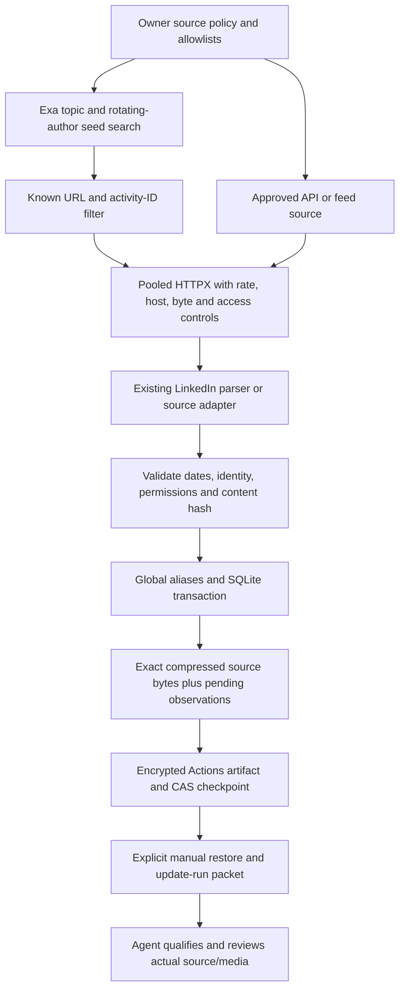

# Collection architecture audit and migration —29 October 2026

## Confirmed baseline and decision

The existing portable runtime is a bounded sequential/wave urllib collector with a shared BeautifulSoup LinkedIn parser, corpus identities, immutable captures, SQLite, Exa through mcporter, and separate media/Whisper/frame/qualification stages. The current public release has279posts,61authors,477snapshots and20prospect summaries. These released inputs and the design/editorial packages are preserved. There was no repository Actions workflow in the audited base revision.

A small migration is appropriate. Retain the parser, source-date rules and analysis/release code. Add a permission-aware collection package beside it. Use pooled HTTPX for static/API requests and SQLite for one serialized writer. PostgreSQL/Redis add deployment, credentials and state complexity without an observed concurrent-writer/high-volume requirement. Scrapy is optional for a separately authorized high-volume non-LinkedIn source. Playwright is optional for a separately authorized JavaScript source. Neither is a fallback for an access denial. No benchmark establishes a need for a browser on the current anonymous LinkedIn post HTML route.

Confirmed bottlenecks: the old Exa wrapper omits the current tool schema's required `objective`; unneeded process/tool startup for direct MCP calls; connection setup without pooling; potential browser startup for static content; and this machine's cloud-backed dependency reads. The latter was observed as stalled imports and resolved for tests with an isolated temporary environment. It is an environment finding, not a scraper latency measurement. No production workload benchmark or PostgreSQL/Redis capacity test was conducted.

## Plan recorded before implementation

1. Freeze the existing parser, historical releases and design/editorial source. Seed the complete known-publication identity set without copying source text into the public repository.
2. Add a common record contract, transport policy, bounded adapters and a single-writer store. Commit each parsed record before fetching the next page. Preserve exact source bytes/hash and original text separately from generated analysis.
3. Compare the actual urllib-policy and HTTPX-policy classes on the same frozen loopback input, concurrency and exact-ID evaluator. Adopt only with parity and measured evidence.
4. Add official OAuth/API access behind real product/scope/actor/resource grants. Do not substitute client credentials for member consent or expose a global-search capability.
5. Add collection-only Actions at12:00and20:00 Europe/Sofia. Restore encrypted persistent deduplication/stop state before source requests. Serialize jobs, fail closed on state loss/orphans, and save partial work on a later source failure.
6. Keep downstream analysis manual. Provide a packet/skill, writing navigation graph and explicit gaps. Scan the activated wrapper and public export, then test/push/read back the scoped source.

## Implemented modules and data path

`contracts.record()` defines source_id, external_id, source_url, author, published_at, collected_at, content_type, exact text/extracted_fields, content_hash, permissions and processing_status. `transport.fetch()` enforces source policy and pooled requests. `adapters.*.collect()` handles static HTML, RSS/Atom and configured JSON. `ReadonlyLinkedInAPIAdapter.collect()` handles only approved read resources. `Store.ingest()` validates and deduplicates. `ci_state.restore/seal/publish()` protects continuity. `cli.collect()` is the bounded unattended entry point. `cli.update_run()` and `scripts/update-run-linkedin` prepare private manual evidence and an unfilled insights table.

Deduplication covers activity ID, underlying share, canonical URL and eligible normalized post text. The bootstrap now contains288known publication identities:279released reference posts,8previously owner-authorized additional posts and1live v7post;62observed actor metadata entries. Comments use distinct composite identities; repeated comment wording does not collapse separate comments. Existing posts are not fetched merely to refresh counters. Therefore this scheduled new-only job cannot measure new velocity for an old post: a separately requested compatible second snapshot is required.

Author records contain observed post-actor metadata, not a scraped complete profile or employee directory. Prospect descriptions remain a separate hypothesis-led view. New-author media still needs reference qualification. Raw HTML retains discovered media references; the scheduled job does not download media bytes or run models. The new packet is not yet an importer into the older analysis-run schema. A tested source-ID/hash bridge is required before those legacy media/ASR/frame stages consume new collector records; until then this is an explicit manual integration gap.

## Discovery and qualification limits

The live keyless Exa route returned4new LinkedIn candidate permalinks in one bounded probe. This proves reachability on that date, not permanent free quota, completeness, freshness or popularity. The normal cycle has at most3queries,8results/query,40candidates and20new stored records. It uses one rotating topic query and two rotating approved-author queries. With48approved paths, one complete author-query rotation takes24runs, about12days at the requested cadence. A14-day date operator is a search hint; only the source page supplies publication dates. Search results are not automatically qualified references.

The existing search/category methods remain authoritative for reference fit, meaning and performance. Record actual observed interactions and denominators. Keep quality, recency, measured change, prospect fit, opportunity hypothesis and buying interest separate. The LinkedIn app currently exposes only verification/basic-profile read and member publishing scopes; none authorize the intended content reads. The official collection API remains disabled. It cannot replace competitor discovery or provide arbitrary top-account/global trend search.

## Benchmark evidence

Both independent local runs used20fixed static records, concurrency1 and the same policy classes. Both adapters captured20/20exact IDs with zero duplicates/errors. Maker mean/p95 latency: urllib4.61/5.55ms, HTTPX1.045/1.175ms. Root repeat: urllib4.63/6.13ms, HTTPX1.039/1.196ms. Root CPU seconds:0.1101versus0.0538. Sampled worker peak RSS:50.88versus37.16MiB. Measurements include the tested local workload; they do not predict LinkedIn network performance. Configured production pacing dominates these millisecond fixture differences.

The raw pooled HTTPX diagnostic is excluded from adoption evidence. Chrome aborted under Playwright in the current environment, so browser startup/latency, JavaScript rendering and browser-child CPU/RSS comparisons remain unavailable. No sandbox weakening was adopted. The benchmark makes no numeric token-saving claim. External provider calls in the loopback benchmark cost$0; hardware, electricity, Actions/storage quotas and operator time are not priced. A total cost per1,000production records remains unknown.

## Verification and unresolved work

See `research/verification/hybrid-v7.json` for the final executed check scope. Tests include denial/challenge stops, Retry-After without early retry, scoped API authorization, pagination, exact raw retention before a later denial, source dates, all required record fields, no-refetch behavior, comment identity, private exports, encrypted state and a Python optimized-mode regression. The skill passes the supported safe installer/SkillSpector2.9.6 static route; semantic/meta LLM analyzers are disabled and reviewed manually. Other sessions must reload it explicitly.

The live OAuth callback is a separate constant Vercel page, not a token server. No real code/token exchange has been performed. GitHub CLI authentication is invalid, so secret configuration and live collection activation require reauthentication. The repository connector can publish source, but does not expose Actions secret/variable configuration. Neither file presence nor a skipped/green job establishes a live schedule. Keep access, source/media/audio/date/coverage, browser and state-recovery gaps visible.

The initial live probe stopped because the detector was too broad: an offline replay showed false positives on all four sampled cached public pages. After correcting that rule while preserving genuine access stops, one live capture succeeded and a second run made zero requests. The current public HTTP source is enabled; the official API stays disabled for missing scopes. Future stop responses retain exact private evidence.

A final same-fixture run after that correction captured20/20records with both transports. Mean/p95 was4.33/5.28ms for urllib and1.11/1.24ms for HTTPX. CPU seconds were0.1079/0.0512; sampled worker RSS45.52/37.25MiB. These final-runtime measurements retain the same fixture/concurrency limits and do not establish LinkedIn production throughput.
